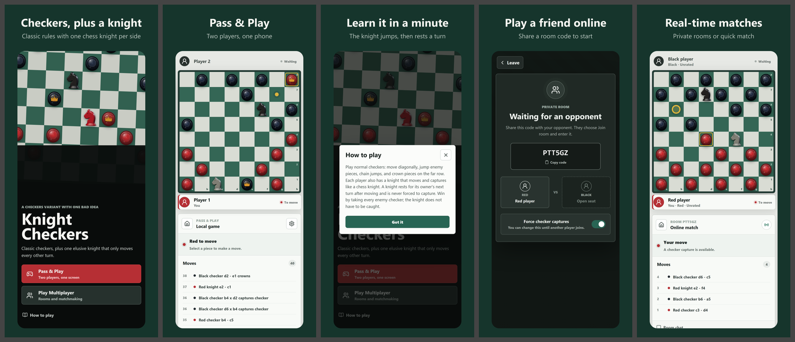

# Knight Checkers

American checkers with one bad idea: each side also gets a chess knight. Play a friend on one screen, play the bot, or play strangers online.

**Status: playable.** The web game is live and complete. An iPhone/Android version is in progress and not in any app store yet.

**Play it:** https://knight-checkers-nu.vercel.app

The first online connection can take up to a minute: the multiplayer server runs on Render's free tier and sleeps when nobody is playing. Pass & Play and the bot work instantly and offline.



## How to play

It's normal American checkers on an 8×8 board, plus one knight per side (Red's starts on e2, Black's on d7).

- Checkers move diagonally, jump to capture, chain multi-jumps and crown into kings on the far row.
- The **knight** moves and captures like a chess knight and is never forced to capture.
- After the knight moves, it **rests for one turn** (it turns gray): your next move must be with a checker.
- Checkers can jump and capture the knight like any other piece.
- You win by taking all of the opponent's checkers (their knight can survive), or when the opponent has no legal move.
- **Red always moves first.**
- An optional "force checker captures" setting makes captures mandatory for checkers (never for the knight).

## Modes

- **Pass & Play:** two players on one device.
- **Play a Bot:** Easy, Medium or Hard; you choose Red, Black or Random. As Black the board flips and the bot opens. The bot runs on your device, so it works offline.
- **Online:**
  - **Private rooms:** share a six-character code. The creator picks a color and the joiner gets the other.
  - **Quick match:** pairs you with the next player who searches, with colors assigned at random. While you wait you can play a bot; a found match takes over immediately.
  - Games survive a refresh or a brief disconnect (30-second grace period), and include resign and rematch.
  - Chat is a fixed set of quick messages ("Good luck!", "Rematch?"…).
  - Every player gets a generated name like `SwiftFalcon27`. Nobody can type text that another player sees.

## How it works

- **Rules engine:** `src/game.ts` is pure TypeScript with no UI. The web client, the bot and the server all use it, so they agree on every rule.
- **Bot:** `src/bot.ts` runs an alpha-beta search with iterative deepening and capture quiescence, inside a web worker. Difficulty levels change the search depth, the time budget and how often the bot deliberately picks a worse move.
- **Server:** `server/game-server.ts` runs Node and Socket.IO and is authoritative. Clients send move IDs; the server validates them with the rules engine and broadcasts a snapshot. Rooms live in memory, so one process handles many rooms, and a restart ends active games.
- **Identity:** each device stores a random player ID and a generated name (`src/playerIdentity.ts`). The server shows only generated names, never forwards player IDs, and accepts only the quick-chat phrases. The IDs exist so ratings and profiles can be added later.
- **Frontend:** React 19, Vite and TypeScript, deployed on Vercel. Every pushed branch gets a preview build, and `main` goes to production.
- **Mobile:** [Capacitor](https://capacitorjs.com) wraps the same web build in `ios/` and `android/` projects. `codemagic.yaml` describes a cloud iOS build to TestFlight (not run yet), and `store/` holds draft privacy, support and listing copy.

## Run locally

```bash
npm install
npm run dev:multiplayer   # web app on http://127.0.0.1:4174 and game server on :4175
npm test                  # unit and server tests
npm run build             # type-check and production build
```

`npm run dev:local` runs only the web app (Pass & Play and the bot don't need the server). The server's health check is `GET /health`.

## Verification

**Automated (`npm test`, 34 tests, all passing):**
- `tests/game.test.ts` covers rules: movement, forced and optional captures, double and triple jumps, king jumps that change direction, crowning, the knight's moves and cooldown, and both win conditions.
- `tests/multiplayer.test.ts` runs a real Socket.IO server with real clients. It covers rooms, joins, rejected out-of-turn moves, resume after a refresh, disconnect grace, resignation, rematch, quick match, color choice, quick-chat-only chat, and keeping player IDs private.
- `tests/bot.test.ts` covers legal moves at every level, taking free pieces, not walking into a capture, finishing multi-jumps, Medium beating Easy, and Hard staying within its time budget.
- `tests/names.test.ts` and `tests/nativeSafety.test.ts` cover generated names, ID validation and the client-side free-text filter.
- GitHub Actions runs the tests and the build on every push to `main`.

**Scripted browser checks:**
- `scripts/e2e-bots.mjs` (Playwright) has 17 checks: bot games, undo, playing a bot during quick match and the match taking over, the flipped board for Black, and a Black-hosted room.
- `scripts/store-screenshots.mjs` drives the real app to produce the store screenshots.

**Checked by hand (2026-10-17):**
- On the deployed site at a phone-sized viewport: a bot game as Black, and a two-browser online room with quick chat against the production server.
- Earlier (2026-08-14): two simultaneous online rooms with four clients.

**Not tested yet:**
- A real iPhone or Android device.
- Compiled native app builds; neither the iOS nor the Android project has been built.
- Bot difficulty against real people.
- Load beyond a handful of simultaneous games.

## Known limitations

- The free Render server sleeps, so the first online connection can take up to a minute, and a server restart ends games in progress.
- No accounts, ratings or leaderboards yet.
- Rematches keep the same colors.
- The native apps aren't built or published. Their bundle ID is a placeholder.
- Branch preview deployments require a Vercel login. Only the production URL above is public.

## Story

Knight Checkers was the first project in Zach Shirley's Foundry portfolio of small games and tools: ordinary checkers with a chess knight dropped in, plus a rule that the knight has to sit out a turn after it moves.

It was built in August 2026 in an OpenAI Codex session: the rules engine, the React UI, the authoritative multiplayer server, and deployment to Vercel and Render. In October 2026 the project moved to Claude Code as the pilot for taking Foundry games to the App Store and Google Play. That pass added:
- the Capacitor shell and the app-store safety rules (no free text, generated names)
- original 3D-rendered piece art
- the bot and color choice
- store screenshots and copy
- auto-deploy from GitHub to Vercel

## AI assistance and Zach's role

Nearly all of the code, tests and art pipeline were written by AI coding agents: OpenAI Codex in August 2026, and Anthropic's Claude (Claude Code) from October 2026.

Zach directed the project:
- came up with the variant and set its rules (knight cooldown, optional forced captures, win conditions)
- chose what to build next: multiplayer, bots, quick chat instead of free text, generated identities, color choice, and the mobile direction
- picked the final art (lacquered knights, a plain gold crown) from five rendered options
- reviewed the results and asked for corrections

The agents designed the implementation, wrote and ran the tests, and verified the deployed build. Manual playtesting on a real phone is still to come (see Verification).

## Attribution

- **Current art:** the knight and crown sprites are original renders made for this project with three.js. The source and pipeline are in `art/`.
- **Earlier art:** earlier versions (still in this repo's git history) used Cburnett's chess pieces from Wikimedia Commons ([`Chess ndt45.svg`](https://commons.wikimedia.org/wiki/File:Chess_ndt45.svg), [`Chess nlt45.svg`](https://commons.wikimedia.org/wiki/File:Chess_nlt45.svg) and [`Chess klt45.svg`](https://commons.wikimedia.org/wiki/File:Chess_klt45.svg)), licensed [CC BY-SA 3.0](https://creativecommons.org/licenses/by-sa/3.0/). The red knight and the scalable king marker were local derivatives. That share-alike licence covers those images only, not this project's code.

## License

No license has been chosen yet. **All rights reserved; the source is public to read.**
